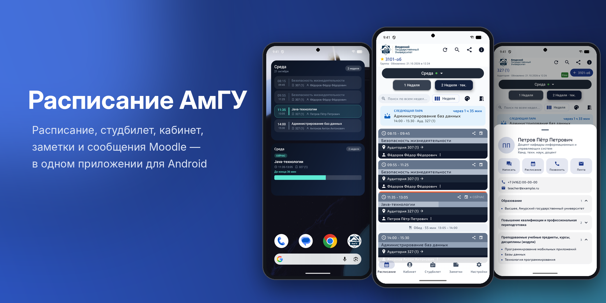
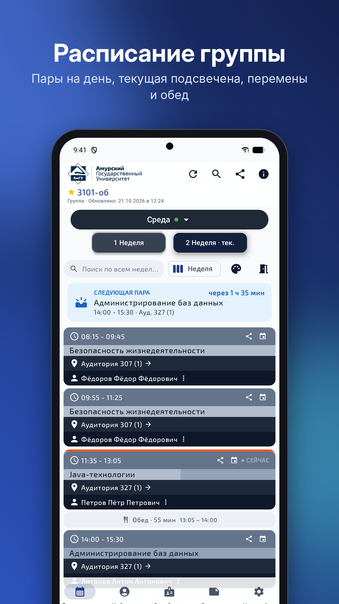
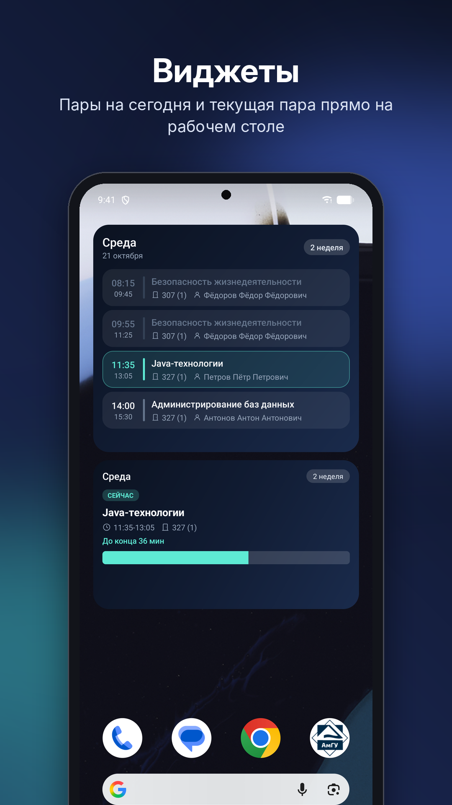
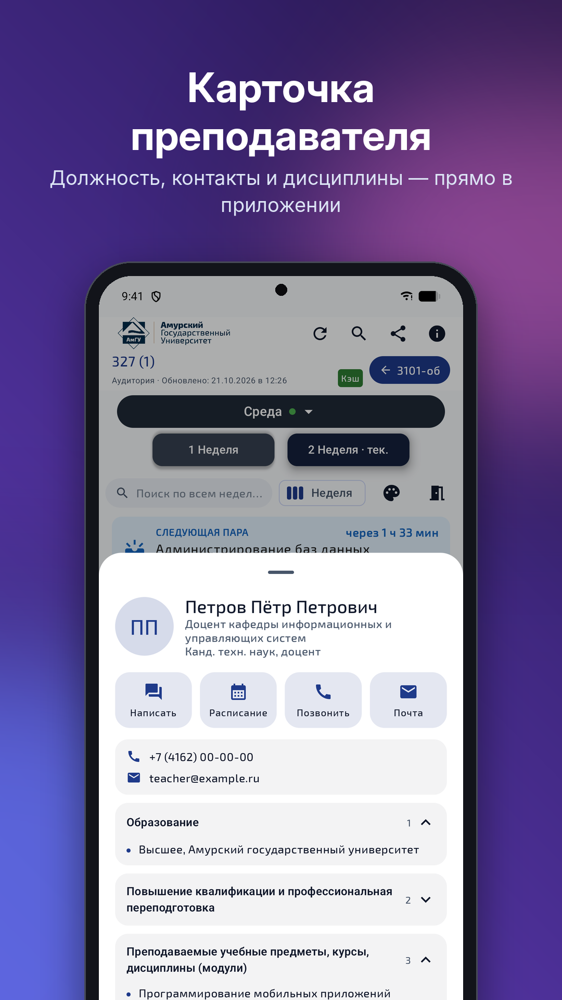
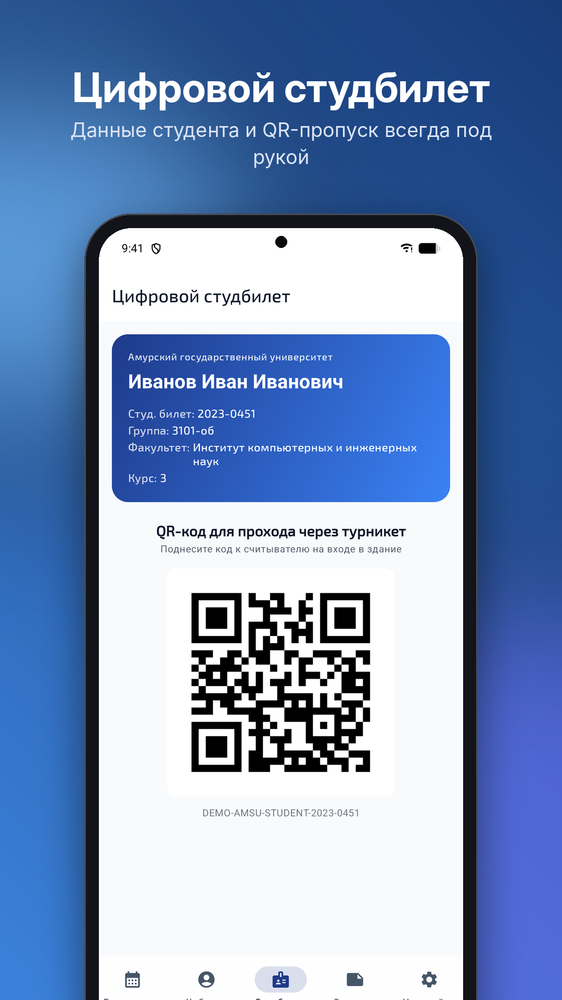
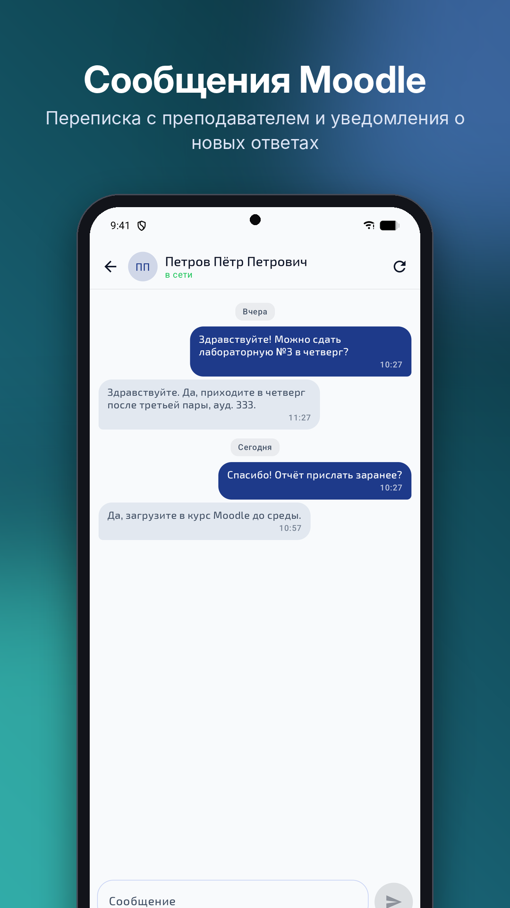
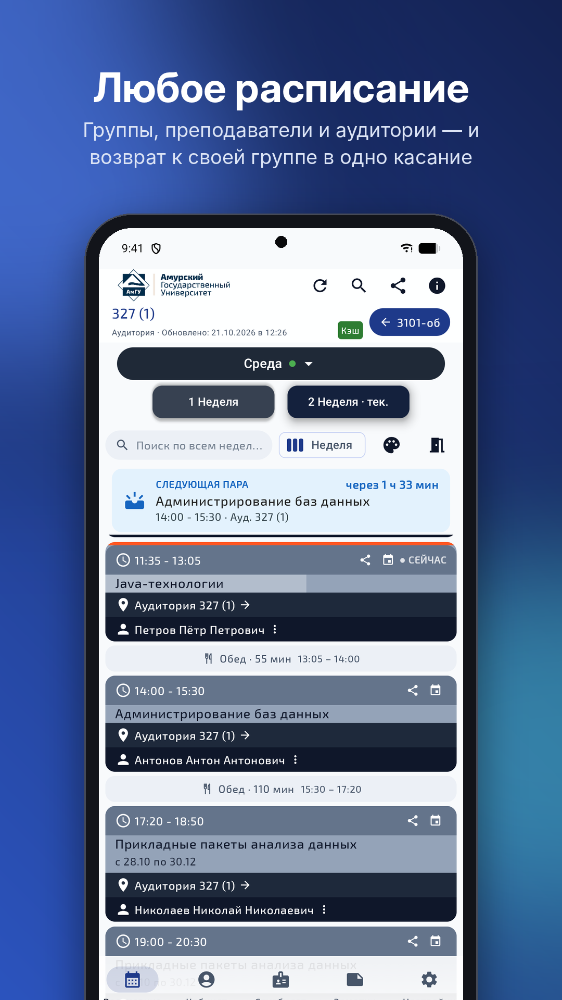
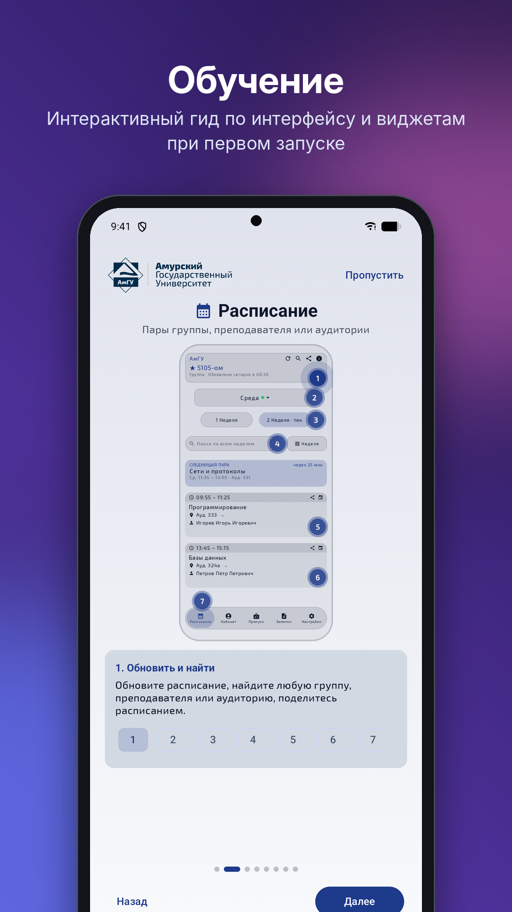

# Расписание АмГУ

Приложение для студентов и преподавателей Амурского государственного университета под Android: расписание, цифровой студбилет, личный кабинет, заметки и сообщения Moodle — в одном месте.

**[Скачать последнюю версию](https://github.com/Tsifrokayf/Schedule_AmSU/releases/latest)** · Android 8.1 и новее ·

## Возможности

**Расписание**
- Расписание группы, преподавателя или аудитории; поиск по всем неделям и сетка недели
- Текущая пара подсвечена, перемены и обед между парами, карточка «Следующая пара»
- Замены и отмены пар, кнопки «Вернуться на сегодня» и «К своей группе»
- Работает без интернета — расписание сохраняется на устройстве
- Напоминания перед парой и режим «Не беспокоить» на время занятий

**Преподаватели и Moodle**
- Карточка преподавателя: должность, контакты, преподаваемые дисциплины — без браузера
- Переписка с преподавателем в Moodle прямо в приложении, вход через личный кабинет без пароля
- Уведомления о новых сообщениях

**Студенту и преподавателю**
- Цифровой студбилет с QR-пропуском
- Личный кабинет: профиль, зачётка, задолженности; электронные журналы для преподавателей
- Заметки, задачи, календарь и таймер продуктивности

**Оформление**
- Виджеты рабочего стола: «День» — все пары на сегодня, «Фокус» — текущая пара с прогрессом
- Темы: светлая, тёмная, динамическая и Liquid Glass с живыми обоями
- Интерактивное обучение при первом запуске

## Скриншоты

> На скриншотах вымышленные данные: студент «Иванов Иван Иванович», преподаватели «Петров Пётр Петрович» и т. п.

| | | | |
|:-:|:-:|:-:|:-:|
|  |  |  |  |
|  |  |  | |

## Установка и обновление

1. Откройте [последний релиз](https://github.com/Tsifrokayf/Schedule_AmSU/releases/latest).
2. Скачайте `AmursuSchedule-<версия>.apk`.
3. Установите поверх текущей версии — данные сохранятся.
4. Если система спросит, разрешите установку из этого источника.

Приложение само проверяет обновления и предложит скачать новую версию.

## Данные и приватность

Логин и данные из личного кабинета используются только для запросов к сервисам университета (cabinet.amursu.ru, newmoodle.amursu.ru) и хранятся на устройстве. Сторонним сервисам эти данные не передаются.

Анонимная статистика: раз в сутки приложение отправляет разработчику случайный идентификатор установки, версию приложения, модель устройства, версию Android и язык системы. Группа, ФИО, логин и содержимое расписания не отправляются. Выключается в Настройках. После сбоя приложение предлагает отправить отчёт об ошибке (текст ошибки, версия, модель устройства); без вашего согласия он не отправляется.

## Благодарности

- Живые обои: [paper-design/shaders](https://github.com/paper-design/shaders) в Android-порте [AndreFrelicot/paper-shaders-android](https://github.com/AndreFrelicot/paper-shaders-android) (Apache-2.0)
- Жидкое стекло: [Kyant0/AndroidLiquidGlass](https://github.com/Kyant0/AndroidLiquidGlass) (Apache-2.0)

## Лицензия

Все права защищены.
